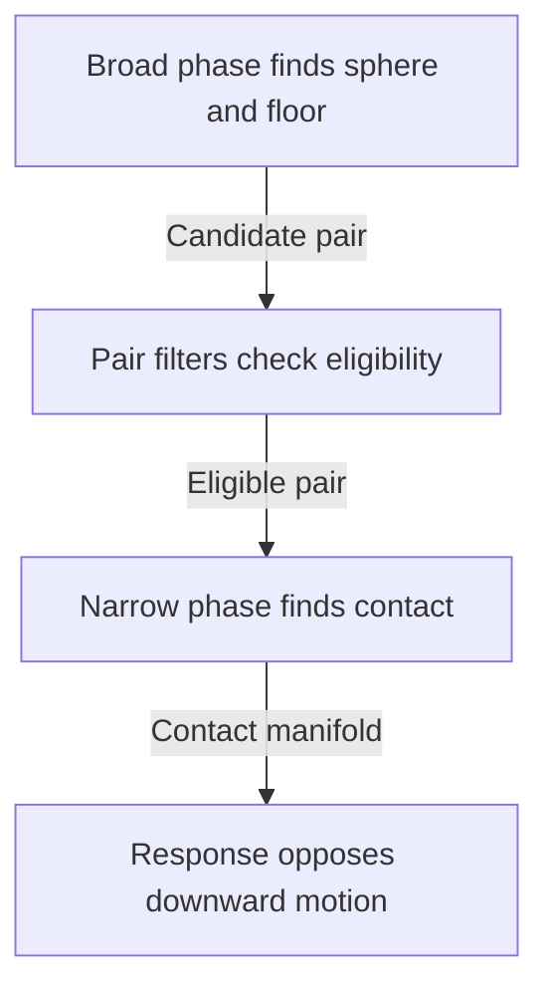

# Collision Pipeline

When a falling sphere meets a floor, Gravitas first finds the pair, checks
where their shapes touch, and uses that contact to change the sphere's motion.
These stages run in `LateSimulate()` in a stable order.

## Quick Read

Follow a dynamic sphere of radius 0.5 onto a solid floor whose top is at
`y = 0`. The floor is a static collider without a body. When the sphere's
bounds reach the floor, the **broad phase** uses shared GridForge voxels to
find the pair. Filters check that the colliders are eligible to interact.

The **narrow phase** checks the shapes themselves and records a **contact
manifold**, the pair's contact points, normals, and depths. At the center
position `y = 0.5`, the sphere just touches the floor. Response uses the
contact to oppose downward motion. The floor remains in place.

Use the [broad-phase guide](COLLISION_BROAD_PHASE.md) to trace candidate
discovery, the [shape reference](COLLIDER_SHAPE_REFERENCE.md) to check pair
support, and the [response guide](COLLISION_RESPONSE.md) to see how motion
and notifications follow contact. If a fast body can cross a thin obstacle
in one step, see [Continuous Collision Detection](CONTINUOUS_COLLISION_DETECTION.md).

## Runtime Paths

| Path        | Body/collider types           | Broad phase                                            | Pair/response owner             |
| ----------- | ----------------------------- | ------------------------------------------------------ | ------------------------------- |
| 3D          | `SolidBody`, `LSCollider`     | `PhysicsPartition` on GridForge voxels                 | `GravitasPhysicsService`        |
| 2D          | `SolidBody2D`, `LSCollider2D` | `PhysicsPartition2D` on the internal Y=0 storage plane | `GravitasPhysics2DService`      |
| Mixed 2D/3D | existing 3D and 2D types      | `PhysicsMixedPartition` using embedded 2D slabs        | `GravitasMixedCollisionService` |

The 3D route pairs `GravitasPhysicsService` with `GravitasCollisionService`.
The planar route pairs `GravitasPhysics2DService` with `GravitasCollision2DService`.

2D uses X/Z host projection: world `Vector3d.x` maps to `Vector2d.x` and world
`Vector3d.z` maps to `Vector2d.y`. World `Vector3d.y` is height or mixed
embedding metadata, not a 2D collision axis.

`PhysicsRuntimeMode.Both` runs 2D and 3D side by side without cross-dimensional
contacts. `PhysicsRuntimeMode.Mixed` adds the dedicated mixed lifecycle.

## End-To-End Phase Order

Collision work is part of `context.LateSimulate()`:

1. Bodies integrate motion and CCD frame state.
2. Dynamic collider bounds and partitions refresh.
3. Active partitions emit candidate pairs in stable order.
4. Pair filters reject invalid or non-physical interactions.
5. Narrow phase evaluates exact shape-pair collision.
6. Contact manifolds are written to pair-owned storage.
7. Contact and joint rows are solved in deterministic islands.
8. The services refresh support, dispatch notifications, maintain pairs, and
   clean up retained partitions and deactivations.
9. Automatic sleep updates after the dimensional collision pass. In `Mixed`
   mode, it waits until after mixed response.

Mixed contacts run after both dimension-local services have integrated and
refreshed their own collider partitions, so mixed response observes
post-integration 2D and 3D positions. When either live dimensional collider
registry is empty, mixed partition copying, sorting and candidate distribution
are skipped. Mixed index refresh, version advancement, pair cleanup and
retained-partition retirement still run, keeping queries fresh and allowing
later registrations to participate on the next pass.

## Pair Filtering

Broad-phase candidate pairs are filtered before exact shape work:

| Filter                        | Purpose                                                  |
| ----------------------------- | -------------------------------------------------------- |
| Context ownership             | Reject colliders from another context.                   |
| Same-agent/hierarchy          | Suppress host-owned sibling/parent-child collisions.     |
| Runtime mode                  | Keep 2D, 3D, `Both`, and `Mixed` behavior explicit.      |
| Mobility/awake state          | Avoid response work for fully sleeping local partitions. |
| Layer matrix                  | Apply context-wide physical collision policy.            |
| Collider-local ignored layers | Apply per-collider physical ignore masks.                |
| Bounds                        | Reject separated broad colliders before narrow phase.    |
| Duplicate partition routing   | Ensure a pair shared by several voxels runs once.        |

Public queries do not use collider-local ignored physical layer masks. Query
include masks are caller-owned; see [Query Services](QUERY_SERVICES.md).

## Narrow Phase

Narrow phase determines whether the shapes touch and where. For the sphere
and floor above, it locates the sphere's lowest point and the corresponding
point on the floor. Supported shape coverage includes:

| Domain | Shape families                                                                     |
| ------ | ---------------------------------------------------------------------------------- |
| 3D     | sphere, capsule, cuboid, finite cylinder, finite cone, mesh, compound              |
| 2D     | circle, capsule, AABB, convex polygon, compound                                    |
| Mixed  | supported 3D shapes against embedded 2D circle/capsule/AABB/polygon/compound slabs |

### Planar Contact Samples

Pure 2D convex contacts retain paired anchors clipped to the finite contact
features. Single-contact consumers, including initial-overlap shape sweeps and
rotational CCD, use the first pair in deterministic geometric order. Reversing
collider order may select a different valid endpoint; the witnesses belong to
the selected finite features rather than unrelated support endpoints.

`ContactManifold2D` preserves independent finite surface groups, with up to two
samples per group. Its flat enumeration follows structural group order, then
contact identity. Group boundaries and supplier materials remain meaningful when
several boundary normals constrain one body; the first sample is not necessarily
the deepest representative. Use `PrimaryContact` for that purpose.

### Convex Shape Tests

Convex support predicates share one GJK simplex policy for 3D contacts and
finite cone overlap queries. Region and face-orientation dot signs use exact
products. Cross-product directions retain the scalar path within a proven
component bound; larger simplices use exact plane-projection and face numerators
before final direction normalization. This avoids intermediate saturation
changing overlap classification as geometry grows or rotates. The existing
strict separation tolerance, stable collinear fallback and conservative
iteration-budget result remain part of the predicate contract.

Convex SAT paths use stable axis generation and pair-oriented normals.
Registered rotated cuboid pairs can build a face manifold after SAT admits
the pair and the selected normal matches a cuboid face. The incident face is
clipped to the finite reference face in local coordinates. Retained samples
use paired anchors, individual depths, and identities derived from the two
faces and the clipping boundaries. Edge axes and clips with no admitted
witnesses retain the single SAT witness.

Cuboid versus capsule checks first solve exact segment-to-oriented-box distance for
rounded features, then use ordered SAT only when the capsule core reaches the
box; inclusive projections and directional exit depths preserve touching and
containment semantics. Closed convex mesh versus sphere checks use the same
whole-hull relation as zero-core capsules. Convex mesh versus capsule checks
reduce the whole capsule against the hull's faces, edges and vertices, retaining
one minimum-exit contact with finite support anchors for exterior overlap,
touching and containment. Cuboid and convex mesh side contacts pair both anchors
against the finite capsule core and the selected support footprint.

Exact clipping chooses the admitted core point nearest its midpoint; endpoint
and radial terms remain separate, with rounding deferred to the final witnesses.
Open convex meshes and concave meshes retain surface semantics for spheres.
Exact interior and finite support-face certificates avoid unnecessary sphere
radial searches. Otherwise the nearest finite edge or vertex supplies the radial
axis; exact feature ranking precedes final anchor rounding. Sphere and capsule
support-face anchors use the first authored triangle containing the exact
projection, rather than ranking differences from final anchor rounding. When a
capsule midpoint projects outside that footprint, exact core parameters are
ranked across its support triangles, retaining authored order for ties.

Other mesh paths use the same deterministic BVH candidate ownership; candidate
order follows the stable built tree rather than authored triangle indices.
Concave mesh/mesh pairs canonicalize relation direction by stable collider ID
and delegate each BVH-admitted triangle pair to FixedMathSharp's full-domain
rigid-frame contact relation. Compound paths scan parts in stable declaration
order and return the owner collider as the public identity.

### Sphere and Capsule Contact on Meshes

Surface mesh/sphere and concave mesh/capsule contacts admit the complete finite
shape before grouping. Triangles join only through a shared edge or vertex that
actually meets the shape. Each connected overlap region has its own face group
capped at four samples, even when several regions share one connected authored
surface. The face direction selects the smaller of the two exact maximum
normal-ray exits from points inside both the shape and the filled surface. Each
face group retains its regional maximum; every additional coverage sample
retains its own matched boundary ray and depth. A crossing capsule core
therefore contributes its finite directional extent, rather than only its
radius. This local surface contract can differ from a whole-mesh minimum
translation.

With positive shape radius, a sphere or a capsule whose axis is exactly parallel
to the face normal retains one contact when its entire plane section lies inside
the surface without meeting a genuine perimeter. Its unique smooth support point
attains the regional maximum; lower-depth rim points are not additional support
contacts. Clipped sections, multiple regions and nonunique support retain the
general finite coverage reduction and independent boundary constraints.

Coverage ranks once-rounded authored mesh points using exact span, area and
filled-triangle distance metrics. Exact authored-point order breaks ties;
admission, connectivity, direction and depth are decided before rounding. True
perimeter edges and corners have separate groups, with support directions
admitted by the actual incident filled fan and the region's selected exit
hemisphere. Covered triangulation edges in trusted coplanar domains never become
constraints. A sphere follows the same path with a zero-length capsule core.
Body rotation does not change sphere or zero-core capsule contact geometry.
Two-sided coplanar domains can contain mixed authored winding: preparation
certifies opposite geometric interiors and orients their boundary chain
consistently without changing the authored triangles.

Overlapping, nonmanifold or otherwise ambiguous topology retains independent
triangle domains. Convex-volume admission still requires consistent winding.

### Cylinders and Round Slabs on Meshes

Native cylinders and mixed circle/stadium slabs share the finite filled-surface
reducer for trusted mesh patches. Covered diagonals cannot supply response; real
outer and hole rims retain their finite-feature constraints. Axial contacts
whose complete footprint is covered reuse one exact cap solve. Admission plus
absence of a true boundary crossing certifies that coverage; a footprint wholly
inside a hole supplies no contact. Distinct surface owners retain independent
contact groups and the supplying collider's material.

A native cylinder whose center is inside or on a closed `Convex` mesh uses a
whole-volume exit before surface response. Exact hull half-spaces admit that
path, including boundary centers. Hull faces, edges and vertices are ranked
against the cylinder's finite caps, side and rims before rounding; the matched
witnesses lie on both finite shapes. This keeps repeated corrections moving out
of the filled hull while the cylinder reaches a wall. Exterior centers retain
the ordinary finite-surface manifolds. Open and `Concave` meshes retain their
surface semantics. Mixed circle and stadium slabs use the same contained-center
volume rule.

Positive-core slabs retain both rounded ends and the finite straight section,
with exact paired witnesses and whole-hull depth selection. Circle queries and
mixed continuous admission share that geometry. The mixed response constraints
still apply: a vertical minimum cannot move a planar-only participant when the
3D participant is immobile.

Isolated or ambiguous native cylinder triangles retain FixedMathSharp's complete
finite-cylinder query. It considers triangle faces, edges and vertices against
the cylinder's flat caps, side and curved rims, rather than inferring contact
from the triangle point closest to the cylinder center. Gravitas may enrich a
selected parallel cap/triangle-face contact with support samples while
preserving the exact depth and clamp flag. A nearly parallel rim contact keeps
its selected witnesses. General math sampling also retains an interior witness,
which can be the only representable witness; a certified covered footprint needs
only its boundary poles. Contact admission, depth and provenance precede final
Q32.32 sampling.

### Cone Contact on Meshes

Mesh/cone contacts include the base disk, rim, apex and lateral generators.
Prepared mesh geometry certifies coplanar surface domains from exact welded
seams and their true boundary, including holes and notches. Ambiguous topology
retains separate triangle domains. Covered triangulation edges in trusted
coplanar domains never become surface constraints. Pose changes reuse this
topology; scale changes publish geometry and topology together after validation.

Joined cone domains keep each member's native rigid frame and supplying
material. They pool admitted face events before reducing samples and omit only
certified shared boundary interiors. An ambiguous canonical surface owner
retains its native finite perimeter on both sides of a proposed join.
Classification cuts inside a retained original edge do not create new physical
corners.

Exact triangle/cone admission precedes grouping. Triangles join only through a
shared edge or vertex that actually meets the cone, so a connected authored
surface can yield several independent contact regions. Each face region chooses
the smaller of its two exact maximum normal-ray exits. A ray starts at a point
inside both the finite cone and the filled surface domain; its paired cone point
is the first exit in that direction. This depth can differ from a global minimum
translation or a remote support-point separation.

Face sampling retains the exact regional maximum, then greedily selects span,
area and distance from the selected triangle using exact metrics on final Q32.32
anchors, up to four samples per group. This finite reduction preserves useful
coverage and torque arms; it does not reproduce a continuous pressure
distribution exactly. Rounding does not decide admission, connectivity,
orientation, depth selection or provenance.

True edges and corners have separate groups. Their support normals satisfy the
actual incident surface fan and the face region's selected exit hemisphere. The
supported cone branches are alternative exits of that feature: only the minimum
exact feature depth and its ties become constraints. Continuous support families
are clipped exactly before finite sampling; final rounded anchor metrics rank
the samples. Redundant final solver rows are merged, while distinct touch
normals remain independent. Group provenance and local contact identities
determine stable order, independent of triangle discovery. Sampling rounds on
the world lattice in one common translated frame, preserving nearest-even ties
even when that frame's origin has odd raw coordinates.

Coverage metrics use these offsets; published contact anchors retain their
collider origins. A conceptual endpoint outside the absolute scalar range can
therefore remain a valid relative contact. Depth is rounded only at
materialization; exact admission distinguishes a positive gap from a zero-depth
touch. Geometry or range failure leaves the pair's manifold unpublished. Closed
convex meshes retain a separate solid-containment fallback when no surface
triangle meets the cone; open sheets have no solid interior. Mixed
mesh/capsule-slab contacts similarly delegate to the complete planar
capsule-slab query. Its flat caps, straight sides and rounded-end rims are
distinct features; the shape is not a rounded 3D capsule or just two end
cylinders.

The selected paired anchors can lie in the middle of the core.

### Mesh Contact with Flat Patches and Prisms

Closed convex mesh contacts against a finite convex mesh patch or an embedded
polygonal prism select the convex-pair separating-axis exit once. Finite support
faces and edges then supply paired anchors for that exit. The existing plane
sample reducer retains up to four spread-out points, or two extreme points for a
support line. Untrusted or nonconvex patches retain triangle-level contacts.

Ordinary mixed contact uses that same owner when the entire mesh is one
certified convex coplanar patch and the other shape is a finite AABB or polygon
prism. Its strict corner ring and genuine perimeter define the finite fill; the
patch gains no solid interior. One minimum exit supplies a contact family, with
the original collider materials, compound namespaces and surface identity. Other
meshes and curved slabs retain their finite-surface contact owners. This
selection can change contact groups, identities and replay hashes across
versions; repeated execution within one version remains deterministic.

Mesh collision and query consumers retain the same exact authored affine map.
Recentering and separately rounded collider centers do not move their shared
vertices or planes. Finite support, boundary certification and curved admission
use that map before final contact-anchor rounding; public centered inspection
vertices are not collision geometry. See the
[mesh coordinate contract](COLLIDER_SHAPE_REFERENCE.md).

### Contact Anchors Near the Coordinate Limits

Finite axes, oriented cuboids, and planar convex shapes retain center-relative
canonical geometry through narrow phase. Contact witnesses use `ContactAnchor`
or `ContactAnchor2D`: a representable origin, normalized frame rotation, and
representable local point. Solvers and replay hashes consume that canonical
frame directly, so a valid contact is not dropped or deformed merely because its
rotated offset or absolute world point crosses a `Fixed64` scalar face.
`Origin`, `Rotation`, `LocalPoint`, and `LocalDisplacement` expose the canonical
components. The two local terms remain separate until exact evaluation so a
representable world witness is not lost to an overflowing local intermediate.

`Offset` and legacy `PointA`/`PointB` views materialize derived coordinates and
throw when the requested view is not representable; domain-edge callers should
use `TryGetOffset` and the matching `TryGetPoint*` method.

### Exact Response When Compact Arithmetic Cannot Fit

Response keeps materialized 2D/3D lever vectors as the ordinary fast path and
reconstructs a Gravitas-owned `ExactLever3D` from contact anchors only when the
complete compact expression cannot be proven representable. Point velocity,
effective mass, warm-start completion, friction, and final body deltas then
remain exact through one final checked narrowing. Compound mass properties use
the Gravitas-owned `ExactMassPoint3D`, `ExactMassPoint2D`, and `ExactMassWeight`
types for the equivalent weighted-center and parallel-axis contract; no
saturated child center or weight is admitted as physical data. These internal
physics semantics consume FixedMathSharp's policy-neutral wide arithmetic
through the intentional friend-assembly boundary and never enter Gravitas public
signatures.

Positional correction subtracts penetration slop and applies the dimensional
correction percentage and contact share before distributing movement by
constrained inverse mass. The compact shared scale retains ordinary rounding
only when neither participant's inverse mass exceeds one; larger inverse masses
would amplify rounding in that scale or its normal components. Those cases use
the exact weighted-distance calculation before applying the contact normal, so
small masses do not consume the correction margin. Both endpoint positions are
checked before either correction is published.

`ExactContactResponseKernel` is the sole owner of the exact normal,
accumulated-normal, Coulomb-line, and Coulomb-disk response policy.
`ExactContactLever3D` and `ExactContactLever2D` adapt body mobility and
dimension-specific state into that kernel; they do not duplicate its arithmetic
or expose the FixedMathSharp internal representation.

### Round Shapes in 2D and Mixed Mode

Pure 2D circle/circle contacts use FixedMathSharp's zero-core capsule relation,
matching the geometry ownership of 3D sphere contacts. Classification precedes
distance and depth rounding, including at tiny and extreme coordinates. Exact
touching is a zero-depth contact; coincident centers use world +X. Radial anchor
terms and the conceptual-depth clamping flag survive manifold construction.

Embedded 2D mixed volumes also select planar boundary anchors semantically.
Built-in circles, capsules, boxes, polygons, and compounds therefore do not
require a public closest point or representable query-to-boundary distance to
produce a contact witness. Exact compound candidate ranking preserves authored
part order on ties.

Mixed cylinder/circle-slab and capsule/circle-slab contacts use the same
complete geometry queries as their 3D counterparts in FixedMathSharp. A
zero-core planar capsule slab is geometrically a circle slab and uses the same
capsule contact query. Cap-rim gaps, tangency and penetration are distinguished
before rounding; the normal and depth come from the complete shape, not a
sampled direction set. Slab half-thickness remains exact even when its full
height exceeds the `Fixed64` scalar domain; it is not saturated into a shorter
cylinder. Gravitas retains the 3D-to-2D normal convention, canonical support
anchors, material ownership, and constrained mixed response. This shared
geometry path does not change the contact rules for other mixed shape families.

Oblique capsule/circle contacts retain the exact algebraic minimum through
output rounding. Proven value bounds narrow the rounding search, and shared
numerator/denominator reduction avoids repeating the same polynomial work.
Neither step changes nearest-even rounding, exact tangency, deterministic ties
or the distinction between rounded depth and conceptual depth clamping. During
root isolation, certified integer point signs can avoid full polynomial
evaluation; uncertain signs still use exact derivative limits for root counting.
Analytic normal rounding reuses scale-dependent products across its threshold
comparisons, including scaled radial anchors, while preserving the same exact
quadratic-sign and nearest-even decisions. Analytic depth and normal searches
use conservative factored square-root bounds.

Normal components share their norm bounds; a nonpositive denominator lower bound
retains the full exact search. Cancellation, half-raw ties and conceptual depth
clamping remain exact.

Capsule contacts with a positive-core 2D capsule slab also use a complete
FixedMathSharp query. The slab's flat caps, straight sides and rounded ends
participate in one minimum-penetration calculation. Treating its middle box and
end cylinders as separate contacts cannot determine that whole-shape depth. Tiny
positive and odd-raw core lengths retain their authored shape and rotation; only
an exactly zero core reduces to the circle-slab path. Capsule radius is included
before separation and rounding, so exact touching remains contact and a positive
sub-raw penetration can correctly return zero rounded depth.

The exact curved solver reuses certified sign evaluation, shared root-count
subdivision and reciprocal-chart isolation. A strictly winning negative
stationary gap can finish traversal only after an exact finite-core projection
certificate proves the complete shape's global closest point. Positive and zero
gaps retain full traversal; this adds no accuracy setting or sampled direction
shortcut. Exact curved contacts can cost substantially more than analytic
contacts; measure representative complete simulation steps when selecting a host
rate or workload capacity.

For shape state, pair matrices, SAT invariants, mesh policy, and compound
ownership details, read [Collider Shape Reference](COLLIDER_SHAPE_REFERENCE.md).

## Continuous Static Surfaces

`StaticSurface` and `StaticSurface2D` extend contact reduction across explicitly
declared static members.
[Host integration](HOST_INTEGRATION.md#continuous-static-surfaces) owns
creation, eligible members, replacement, and lifetime. A 3D declaration joins
finite triangle surfaces authored in `MeshColliderMode.Concave`; the geometry
may itself be convex or closed. A 2D declaration joins the filled planar union
of AABB and convex polygon pieces. Members keep their own collider identity,
transforms, bounded geometry, spatial partitions, and mesh triangle BVHs. A
surface has no combined body, mass, inertia, or world-sized collider radius.

Only an exactly covered, nonzero boundary span can lose its internal rim.
Unequal subdivision and partial edge coverage can join; point-only touches,
gaps, overlapping fills, and ambiguous or nonmanifold joins cannot erase edges.
Matching uses committed scaled-local geometry and stored rigid transforms before
world-point rounding. Equal rounded endpoints do not prove a join. There is no
proximity welding or snapping. Real creases, outer edges, finite endpoints,
holes, and disconnected regions retain their physical geometry.

Finite-shape admission precedes connected-region reduction. A filtered,
trigger-only, inactive, or unloaded neighbor cannot hide an eligible member's
rim. Retained constraints preserve independent genuine-boundary groups and the
actual supplying member's material and feature identity, even when another
member carries those solver rows. Material changes alone do not create holes.
Geometric overlap events remain per member; sharing response constraints does
not manufacture contact exits.
[Queries](QUERY_SERVICES.md#continuous-static-surface-queries) also retain
per-collider hits. CCD uses the same admitted physical boundaries without
treating a covered internal edge as a blocker.

Local penetration stabilization does not promise a one-step whole-surface exit
or a global minimum translation. Pure 2D primitive recovery certifies the final
representable pose against its complete eligible spatial neighborhood, including
geometry absent from the initial overlap set. Endpoint clearance does not
promise a clear path to that endpoint. Deep compound recovery is unsupported:
clearing one leaf does not establish clearance for its owner. If a
response-required movable, nontrigger 2D overlap has neither genuine boundary
rows nor certified recovery, the runtime throws a deterministic
`InvalidOperationException`. Trigger, query-only, and static/static observations
retain geometric results. Stop a failed fixed step and restore or reinitialize a
known valid state before stepping again; the step has no rollback guarantee.

## Continuous Collision Detection

CCD is opt-in per body or through context defaults. The runtime supports:

- static/kinematic blockers for fast dynamic bodies.
- dynamic-vs-dynamic candidate indexing and relative movement checks.
- host-driven kinematic active sources.
- rotational CCD where supported.
- service-level handoff queues for chained contacts.
- mixed handoffs when `PhysicsRuntimeMode.Mixed` is active.

Sphere/cuboid time of impact uses the exact spherical dilation of the oriented
cuboid. The local-space reducer distinguishes planar faces from rounded edges
and corners, then reconstructs contact from the original authored world chord
without normalized-direction loss.

The CCD reference explains exact reducer paths, conservative proxy boundaries,
TOI ordering, and service counters:
[Continuous Collision Detection](CONTINUOUS_COLLISION_DETECTION.md).

## Response And Notifications

Non-trigger contacts are solved through deterministic manifold response. 3D and
mixed manifolds retain independent surface groups capped at four point samples
each. Sequential rows read current velocities while restitution uses incoming
motion captured before island warm starts. Multipoint pairs honor the configured
solver budget even when they form the only pair in an island. Mixed pairs reuse
retained geometry while committed poses and contact dependencies remain current.
Reuse still checks collision eligibility and bounds, publishes the current
frame, delivers notifications, and clears per-step impulses. It does not enable
cross-frame mixed warm starts. Pure 2D and mixed response revalidate pending
pairs after contact callbacks.

In pure 3D, an isolated flat cuboid patch can solve its normal rows together
when a free body approaches a fixed support with only normal motion. The
finite patch must admit a load distribution that stops the body at the
ordinary solver tolerance. The rows must have a common depth, so the first
row owns the position correction. Sliding, spinning, rebounding, and
overhanging contacts continue through the ordinary row solver.
The two-contact 3D cuboid seed can also carry a lighter or equal load through two
flat patches with a shared support axis when both bodies can come to rest
and both position corrections are representable.

In pure 2D, a two-contact convex island can solve its normal load together
when a freely moving body carries a heavier one over a fixed support.
The unilateral solve includes each contact's linear and angular response
and requires inelastic rows and representable body velocities. The ordinary
row sweeps refine friction against these normal loads. After the velocity
sweeps, an eligible island solves both support translations together from the
deepest row at each interface. The solve retains the signed distance to
penetration slop so moving the shared body accounts for both interfaces. An
interface with inconsistent directions or clamped depths, or a solve that
cannot prepare both poses, uses the ordinary pair position corrections.

Changed geometry or eligibility rebuilds their constraints before solving;
retiring a pair removes its pending response before its object can be pooled and
reused. Physical overlap notifications remain independent of response-row
ownership: a surface member can retain its events while another overlapping
member carries shared constraints and their finite supplier materials. Bodyless
trigger volumes skip physical response and emit trigger notifications only when
exactly one collider in the pair is a trigger and the other collider is
body-owned. Both colliders in a valid trigger pair receive enter, stay, and exit
callbacks.

2D, 3D, and mixed pair callbacks use stable pair order: A/B for same-dimension
pairs and 3D/2D for mixed pairs. Exit admission is consumed before user
delegates run, so callback failure or reentrant teardown does not retry an
already admitted exit against the same pair lifetime. Both admitted sides are
attempted even if the first throws: one exception is re-thrown with its original
stack, while multiple failures are reported as an `AggregateException` in pair
order. Deferred exits retain the pair's notification guard until cleanup
finishes, preventing direct deactivation from reentering the same separation.

`SolidBody.TryReconfigureCollider(...)` keeps its transaction status separate
from post-commit notification failure. After physical publication, its optional
synchronized-state publisher runs before pair exits, so a coordinating consumer
can publish dependent state before any callback observes the transaction. Pair
retirement continues across publisher or callback failures before one exception
is returned directly through `notificationException` or several are aggregated.
A notification failure must not be treated as a request to retry the already
accepted shape change.

3D and 2D response both:

- combine contact rows with enabled joint rows.
- build deterministic body islands.
- wake connected sleeping bodies when an island has an awake participant.
- apply warm-start impulses from pair-local caches.
- solve bounded iterations from `PhysicsSettings.DiscreteSolverIterations`.
- update sleep state after response.

Mixed response is constrained: 2D participants receive planar X/Z correction,
planar velocity deltas, and scalar yaw angular deltas. Vertical Y impulse is
constrained out of the 2D body model.

For contact manifolds, material response, warm-start caches, sleep/wake, and
event timing, read [Collision Response](COLLISION_RESPONSE.md).

## Common Extension Points

| Goal                                               | Start with                                                                                             |
| -------------------------------------------------- | ------------------------------------------------------------------------------------------------------ |
| Add or improve a shape pair                        | [Collider Shape Reference](COLLIDER_SHAPE_REFERENCE.md), then shape-pair tests.                        |
| Change broad-phase partition behavior              | [Collision Broad Phase](COLLISION_BROAD_PHASE.md), then partition/candidate benchmarks.                |
| Change tunneling behavior                          | [Continuous Collision Detection](CONTINUOUS_COLLISION_DETECTION.md), then CCD replay and stress tests. |
| Change friction/restitution/contact solve behavior | [Collision Response](COLLISION_RESPONSE.md), then response invariant tests and benchmarks.             |
| Add host-facing query behavior                     | [Query Services](QUERY_SERVICES.md) and [Query Reference](QUERY_REFERENCE.md).                         |

## Rules That Matter

- Preserve deterministic pair, partition, contact, and response ordering.
- Use `Fixed64`, `Vector2d`, `Vector3d`, and fixed-point geometry in runtime
  collision code.
- Keep 2D, 3D, and mixed collision paths explicit.
- Do not compare plain collider IDs across dimensions.
- Avoid LINQ and iterator allocations in collision hot paths.
- Pool only when lifetime and ownership are obvious and testable.
- Add focused tests for separated, touching, overlapping, degenerate, rotated,
  and high-speed cases when changing collision behavior.
- Add benchmarks for partitioning, pair distribution, narrow phase, CCD, or
  response loop changes.

## Source Map

- [3D collision service](https://github.com/mrdav30/Gravitas/blob/main/src/Gravitas/Core/3D/Services/GravitasCollisionService.cs)
- [3D physics service](https://github.com/mrdav30/Gravitas/blob/main/src/Gravitas/Core/3D/Services/GravitasPhysicsService.cs)
- [3D pair lifecycle](https://github.com/mrdav30/Gravitas/blob/main/src/Gravitas/Core/3D/Services/GravitasPhysicsService.Pairs.cs)
- [3D response scheduling](https://github.com/mrdav30/Gravitas/blob/main/src/Gravitas/Core/3D/Services/GravitasPhysicsService.Response.cs)
- [2D collision service](https://github.com/mrdav30/Gravitas/blob/main/src/Gravitas/Core/2D/Services/GravitasCollision2DService.cs)
- [2D physics service](https://github.com/mrdav30/Gravitas/blob/main/src/Gravitas/Core/2D/Services/GravitasPhysics2DService.cs)
- [2D pair lifecycle](https://github.com/mrdav30/Gravitas/blob/main/src/Gravitas/Core/2D/Services/GravitasPhysics2DService.Pairs.cs)
- [2D response scheduling](https://github.com/mrdav30/Gravitas/blob/main/src/Gravitas/Core/2D/Services/GravitasPhysics2DService.Response.cs)
- [Mixed collision](https://github.com/mrdav30/Gravitas/tree/main/src/Gravitas/Core/Mixed)
- [Narrow phase](https://github.com/mrdav30/Gravitas/tree/main/src/Gravitas/CollisionHandling/Detection)
- [Contact data](https://github.com/mrdav30/Gravitas/tree/main/src/Gravitas/CollisionHandling/Contacts)
- [Response](https://github.com/mrdav30/Gravitas/tree/main/src/Gravitas/CollisionHandling/Response)
- [Collision tests](https://github.com/mrdav30/Gravitas/tree/main/tests/Gravitas.Tests/CollisionHandling)
- [2D physics tests](https://github.com/mrdav30/Gravitas/tree/main/tests/Gravitas.Tests/Physics2D)
- [Mixed-dimension tests](https://github.com/mrdav30/Gravitas/tree/main/tests/Gravitas.Tests/MixedDimensions)
- [Sphere and floor tests](https://github.com/mrdav30/Gravitas/blob/main/tests/Gravitas.Tests/CollisionHandling/BodylessStaticResponseTests.cs)
