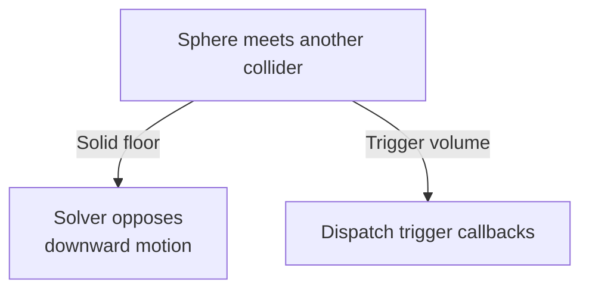

# Collision Response

Collision response turns contact data into changes to motion. For a solid
contact, the solver can push bodies apart, reduce sliding, or produce a
bounce. The [collision pipeline](COLLISION_PIPELINE.md) explains how the
contact reaches the solver.

## Quick Read

A radius-0.5 sphere at center position `y = 0.5` touches a floor with its
top at `y = 0`. The contact normal lets the solver oppose downward motion.
Friction can oppose motion along the floor. A bodyless floor supplies
geometry and material and stays immobile.

If a trigger volume and the same sphere pass pair filtering and overlap,
Gravitas dispatches trigger callbacks. The overlap applies no physical
impulse to the sphere.

To inspect the data used for response, start with
[contact manifolds](#contact-manifolds). Check [materials](#materials) for
friction and bounce, [response islands](#response-islands) for connected
bodies, and [notifications](#notifications) for which callbacks fire.

## Contact Manifolds

A manifold describes where two shapes meet. The sphere and floor example
uses a single contact point. Wider contact regions can retain several points
to give the solver useful leverage against rotation.

### 3D Contact Groups

The 3D narrow phase writes a `ContactManifold` owned by the `CollisionPair`.
`ManifoldContact` stores:

- stable contact identity derived from unordered canonical local anchor features
  and compound namespaces; world pose is excluded.
- point on collider A.
- point on collider B.
- penetration depth.
- normal oriented from collider A toward collider B.

3D manifolds retain independent geometric groups, with up to
`ContactManifold.MaxContactsPerGroup` (four) point samples per group. Within a
group, the reducer keeps the deepest samples, prefers conceptually clamped
depths on equal rounded depth, then breaks ties by lower contact identity.
Groups use full structural provenance: A/B compound namespaces, A/B surface
ordinals and region identity. Groups and their point identities have canonical
order; a group or triangle count is never a pressure weight. Primitive contacts
use the default group, and compound part contacts retain independent namespaces.
Mesh contact producers determine which regions they admit. Mesh/cone face
regions and real boundary features retain independent constraints.

Their finite samples cover the admitted geometry; coincident anchors can still
carry distinct normals at exact touch. Rotational CCD selects a closing impact
row using the sampled bodies' contact-point velocities, rather than assuming the
deepest row is the impact witness.

### Inspecting a 3D Manifold

`Count`, the indexer and enumeration expose flattened group/point order;
`GroupCount`, `GetGroupStartIndex` and `GetGroupContactCount` support
inspection. There is no fixed pair-wide group or sample cap. Flattened order
follows full structural group provenance, then ascending contact identity; index
zero is not necessarily the deepest sample. Use `PrimaryContact` for
deepest-contact inspection, and inspect all groups when independent constraints
matter. The former pair-wide `MaxContactCount` constant is replaced by
`MaxContactsPerGroup`. The common single group is inline; overflow storage grows
on demand and remains with the pair after reset or pooling. First-ever capacity
growth can allocate; regeneration at a retained high-water mark does not. Warm
starts follow the same grouped ownership and are pruned after narrow-phase
regeneration, including when response is skipped.

### 2D Contact Groups

2D narrow phase writes `ContactManifold2D` into `CollisionPair2D`. It retains up
to `ContactManifold2D.MaxContactsPerGroup` (two) samples per geometric surface
group, with no fixed pair-wide group or contact cap. Circle/circle and
circle/convex contacts normally produce one sample; one convex/convex face can
produce two. Independent finite regions and boundary normals retain separate
groups and supplier materials.

As in 3D, flattened order follows structural group provenance and contact
identity rather than depth. Use `PrimaryContact` for deepest-contact inspection
and the group APIs when independent constraints matter. Overflow capacity stays
with the pair across resets; reaching a new high-water mark can allocate.

Contact depth is narrow-phase world distance. Solver slop belongs to response,
not contact data.

## Response Islands

An island is a group of bodies connected by contact or joints. The solver
handles the connected constraints together. An immobile floor shared by
otherwise unrelated bodies does not merge their islands.

### Which Bodies Solve Together?

After active partitions distribute candidates, the owning physics service sorts
queued response pairs by stable pair key and combines them with enabled joints:

| Domain | Contact rows                            | Joint rows | Island key                 |
| ------ | --------------------------------------- | ---------- | -------------------------- |
| 3D     | `CollisionPair` / `ContactManifold`     | `Joint3D`  | `SolidBody.DynamicId`      |
| 2D     | `CollisionPair2D` / `ContactManifold2D` | `Joint2D`  | `SolidBody2D.DynamicId`    |
| Mixed  | `CollisionPairMixed` / `MixedContact`   | none       | dimension-tagged body keys |

Fully sleeping islands are skipped. If an island contains an awake participant,
connected sleeping dynamic bodies are woken in deterministic order. Contact-only
single-row 3D scenes stay on a direct response path when no active joints exist.
A lone 3D pair with multiple points uses the configured iteration budget, as
does the public `CollisionResponse.CalculateImpulse` entry point. The 2D owner
keeps its own dimensional scheduling policy.

### Iteration Budget and Joint Repair

Multi-constraint islands run a bounded number of iterations from
`PhysicsSettings.DiscreteSolverIterations`. Cached warm-start impulses and
positional correction are applied on the first island iteration; later
iterations refine velocity response.

Joint structural rows target 40% of their positional or angular error per
fixed step. Their bias has velocity units: correction fraction times error
divided by the step duration. Motor drive gains already target velocity and
are independent of this conversion.

For 3D joints, the island shares a linear repair rate of
`min(1 / DeltaTime, MaxSpeed / totalCorrectableAnchorDistance)`. The distance
sum excludes components with zero effective response, including frozen axes
that cannot move through either translation or anchor rotation. This limits
the total requested repair to 40% of `MaxSpeed`, retaining correction headroom
for a connected chain. Large, stretched islands therefore repair more slowly
than small errors; the rate depends on the connected topology. Angular rows
keep the fixed-step rate. If contact position correction makes a subsequent
joint bias unrepresentable, that joint rejects its rows before applying warm
impulses. An overflowing error on a zero-response frozen row contributes no
bias, preserving the joint's feasible rows. Unrepresentable anchors reject
only that joint, without suppressing a valid neighbor's repair.

A 3D joint speed ceiling limits the common impulse scalar before either endpoint
is published. Both linear and angular speeds constrain that scalar, and the
joint caches the impulse actually applied. Frozen-axis projection and the body
owner's low-speed cutoff still apply. This preserves the shared impulse at the
speed ceiling without changing motor impulse bounds per row and iteration.

## Position Correction Limits

Pure 3D, pure 2D and mixed correction preserve the existing correction fraction,
mass weighting and ordinary rounding. If the common inverse-mass scale, sum or
rounded multiplication cannot fit, response computes the representable per-body
weighted distance with an exact ratio before applying the normal. Large or small
masses do not justify truncating otherwise valid movement.

Each correction projects frozen axes and checks both final positions before
publishing either participant. An unrepresentable position raises
`OverflowException`; it is not a physical wall or a partial correction. Earlier
constraints may already have been solved. Hosts must stop and restore a failed
step rather than continue from its partially advanced state. See
[representable body positions](HOST_INTEGRATION.md#representable-body-positions).

## 3D Response

Non-trigger 3D response:

1. captures incoming motion and COM-relative lever frames before any island warm
   start or joint solve.
2. derives linear and angular mobility independently from mass, inertia, role
   and frozen axes.
3. corrects position once per identical admitted normal direction, using its
   deepest depth above `PenetrationSlop` and the existing correction fraction.
   Other directions do not dilute correction; separate lever samples remain
   independent velocity constraints. This translation policy is not an exact
   multi-contact depenetration solve.
4. applies compatible grouped warm starts in canonical order.
5. solves and immediately applies each accumulated normal delta against current
   linear/angular point velocity, clamping accumulated normal impulse at zero.
6. fixes restitution to incoming motion before warm starts, so later iterations
   refine the same target instead of retracting bounce.
7. resolves per-contact materials and solves the two-axis Coulomb disk against
   that row's actual accumulated normal load.
8. stores each row's normal/tangent impulses independently. A failed velocity
   representability preflight clears only that row's cache; other rows continue.

### Contact Normals and Multi-Point Loads

Admitted nonzero normals are authoritative. Collider-center direction is a
fallback only for a genuinely zero legacy normal. Contained sphere contacts with
finite cones/cylinders retain the solid's outward escape normal and sphere's
inward support. Exact kernels preserve frozen lever frames and incoming motion
through completed impulse/body-delta rounding.

Sequential multipoint response has a finite-iteration residual. More
`DiscreteSolverIterations` improve convergence at additional cost, including for
symmetric face contacts. Choose the budget using representative quality and
frame-time measurements.

A joint-free cuboid island with a fixed support and two freely moving cuboids
can seed both interfaces together when the supported body carries a heavier
cuboid. The bounded solve uses up to eight normal
rows and keeps compatible cached friction in an unchanged tangent basis.
It prepares both bodies before applying impulses, then uses the configured
row sweeps to refine the normal and friction response. If each interface
shares one normal direction, the deepest depth on each interface can also
drive one coupled translation correction. The ordinary sequential path
handles restitution, constrained motion, larger islands, and cases where the
coupled state cannot be prepared within the numeric limits.

### Torque Arms and Friction Precision

3D response torque arms are measured from `SolidBody.WorldCenterOfMass`.
Collider centers remain collision-geometry references for narrow phase, culling,
and normal fallback; they are not implicit body COM.

Ordinary-domain 3D friction stays on a checked compact path. If point velocity,
effective mass, cache accumulation, disk clamping, or final velocity
materialization cannot be proven representable there, response falls through
once to the exact two-axis Coulomb-disk kernel. The exact path keeps both
tangent accumulators in exact rational/radical form through static retention,
dynamic radial projection, and cache removal, then rounds only the final body
deltas and representable cache projections. Friction application is atomic
across both bodies; a true final friction overflow does not undo the normal
response that was already applied earlier in the solver phase.

## 2D Response

2D response uses 2D-specific solver data:

- `ResponseBody2D`
- `SolverContact2D`
- `SolverContactBuffer2D`
- `SolidBody2D.EffectiveInverseMass`
- `SolidBody2D.EffectiveInverseMomentOfInertia`
- `SolidBody2D.WorldCenterOfMass`

Translation-frozen dynamic bodies contribute zero constrained inverse mass but
retain scalar angular inertia when yaw remains free. Yaw-frozen bodies retain
their available linear response. Static, kinematic, inactive, and
non-positive-mass states contribute neither applicable solver value while raw
mass and scalar moment stay inspectable. 2D contact response applies planar
linear velocity deltas and scalar angular velocity deltas from COM-relative
normal and tangent friction impulses.

Ordinary 2D friction uses the compact scalar tangent solve only while point
velocity, effective mass, friction limits, cache accumulation/removal, and final
body deltas remain representable without losing nonzero terms. Failed proofs
route once to the exact Coulomb-line owner, which keeps the cached tangent
impulse and solved delta exact until final round-to-even materialization.
Static-limit classification uses the signed interval directly, so
`Fixed64.MinValue` is not mistaken for a smaller saturated magnitude.

## Mixed Response

Mixed contacts are solved inside `GravitasMixedCollisionService` after both
dimension-local services have integrated bodies and refreshed their colliders.

Mixed response applies:

- X/Z penetration correction to movable 2D participants.
- planar normal impulse and friction impulse to 2D linear velocity.
- scalar yaw angular velocity deltas from planar COM-relative impulse arms.
- vertical Y correction/impulse only to the 3D participant.

The 2D body is treated as having infinite constrained mass along world Y.
`PhysicsRuntimeMode.Both` never creates mixed contacts.

Mixed friction maps 2D linear velocity and contact arms explicitly into world
X/Z before constructing point velocity. The compact path proves tangent
projection and normalization, every linear/angular effective-mass term,
friction-limit multiplication, and final impulse materialization. Any failed
proof routes once to the existing uncached exact Coulomb disk; no parallel mixed
wide solver or warm-start cache is introduced. Exact fallback preserves the same
planar constraint: world Y response remains exclusive to the 3D participant.

## Materials

`PhysicsMaterial` is collider surface data. `LSCollider`, `LSCollider2D`,
authored shape definitions, and compound parts can carry a material. Compound
parts without an explicit material inherit the owning compound collider material
when private part colliders are materialized.

Response rules:

- restitution is clamped to `[0, 1]`.
- default restitution combine policy is `Minimum`.
- materials can choose `Minimum`, `Maximum`, `Average`, `Multiply`, or
  `GeometricMean`.
- differing policies resolve deterministically in ascending precedence:
  `Average < Minimum < GeometricMean < Multiply < Maximum`.
- closing speeds at or below `PhysicsSettings.RestitutionVelocityThreshold` use
  zero restitution.
- static and dynamic friction are non-negative Coulomb coefficients.
- dynamic friction must not exceed static friction.
- values above one are allowed for intentional high-friction surfaces.

Friction impulses oppose tangential contact motion and are clamped by normal
impulse and resolved material coefficients. Static friction can stick within the
static bound; sliding clamps to the dynamic bound.

## Joint Metrics

3D joint rows write `JointSolveMetrics3D` to the owning `Joint3D`. 2D joint rows
write `JointSolveMetrics2D` to the owning `Joint2D`.

Metrics include prepared row count, pre-solve anchor error, limit error, motor
error, cached impulse magnitude, incremental impulse magnitude, motor impulse,
and clamped row count. These are deterministic diagnostic/stress signals, not
separate tuning knobs.

## Sleep And Wake

`SolidBody` and `SolidBody2D` own deterministic sleep state. A dynamic
non-kinematic body can sleep after linear and angular speed remain at or below
explicit thresholds for `SleepFrameThreshold` fixed frames.

### How an Island Goes to Sleep

At the end of a managed late physics step, automatic sleep waits for every
movable body in a connected component to meet its own quiet threshold or
already be asleep. A member with sleep disabled keeps the component awake.
Forces and torques queued for the next integration also keep it awake.
Solid contacts and enabled joints connect movable bodies. Bodies can settle
independently on a shared static floor. In Mixed mode the decision follows
all response phases and includes mixed contacts that couple planar motion.
Explicit `Sleep()` and `Wake()` operate on the requested body immediately.

Sleeping clears accumulated force, velocity, torque, acceleration, and pending
position-correction state, but does not remove the collider from GridForge
partitions.

### What Wakes a Body?

Deterministic wake stimuli include:

- explicit host wake through `Wake()`.
- non-zero force.
- non-zero linear impulse.
- non-zero angular impulse or torque.
- collision with an awake body.
- kinematic host motion.
- host transform teleport.
- collider shape mutation.
- loss of an established solid contact, or a change to its counterpart's
  committed shape, explicit pose, material, or solid/trigger classification.

Waking refreshes the collider's awake membership across current partitions.
Discrete response expands wake across connected dynamic contacts in
deterministic body-ID order.

Contact dependency changes invalidate cached automatic grounding before motion
resumes. Manual grounding stays host-owned. Equal assignments, trigger-only
separations and accepted solver corrections preserve unchanged sleeping
contacts. A mixed contact affects 2D wake only when its old or replacement rows
couple to planar motion.

Query-derived automatic support uses the same wake outcome without requiring a
contact pair. A changed collider lifetime, committed geometry, filter, or probe
mode, radius, origin or reach revalidates the accepted point and normal. Losing
or changing that result wakes the sleeper; an identical result retains sleep.
Support caches are derived runtime state and are reconstructed after loading.
Grounding callbacks may take manual ownership or replace a body; the old refresh
must not overwrite that state or continue preparing the old lifetime's motion.

## Notifications

### Retaining Contact Pairs

Unused colliders retain lazy pair-lookup storage. First contact prepares both
owner and holder lookup roles, so a later role reversal can reuse that storage.
Spatial registration reserves a return-stack baseline proportional to collider
count, matching planar registration. Dense pair graphs and first visits to new
partition roles can still require additional storage.

Collision pairs are queued into the physics service active-pair queue the first
time they update. During late simulation, active pair maintenance:

- deactivates pairs that have not collided for the inactive-frame threshold.
- validates retained live contacts when either collider's published geometry
  changes, including pairs skipped by partition distribution.
- emits ongoing contact notifications when a pair is active and not culled.
- delivers pending separation without waiting for a collision-check cull
  countdown.
- keeps active pairs queued for later maintenance.

Unchanged sleeping contacts retain their manifold and warm-start cache. Changed
geometry must still overlap in bounds and pass narrow phase before an old
contact is retained; invalid contacts retire and emit their admitted exits in
the same maintenance pass. This prevents both false exits during rest and stale
contact notifications after a support moves or changes shape. This validation
does not run response a second time. Ordinary noncontact candidates retain their
inactive reuse lifetime.

Pure 2D and mixed pair cleanup uses the context's late-step token for contact
freshness. `LastFrame` continues to describe the public frame clock; repeated
`LateSimulate()` calls without `Simulate()` still perform separation cleanup.

### Which Callbacks Fire?

`LSCollider.NotifyContact(...)` and `LSCollider2D.NotifyContact(...)` emit:

- `OnTriggerEnter`, `OnTriggerStay`, and `OnTriggerExit` when exactly one
  collider is a trigger volume and the non-trigger collider is body-owned.
  Both colliders are eligible to receive the callback. During enter or stay,
  the first callback can deactivate a participant or cause separation, which
  skips the second active-contact notification.
- `OnContactEnter`, `OnContact`, and `OnContactExit` for body contacts.

Contact callbacks receive the other `SolidBody` or `SolidBody2D`. A bodyless
floor can receive these callbacks for a dynamic visitor; the visitor receives no
body-contact callback for the floor because the floor has no body.

Mixed pairs follow the same rule with `OnMixedTriggerEnter`,
`OnMixedTriggerStay`, and `OnMixedTriggerExit`. Trigger pairs never emit contact
callbacks and do not participate in physical response.

## Diagnostics

When diagnostics are enabled, response emits events in deterministic processing
order:

1. `Contact`
2. `ResponseImpulse` for fresh normal-solve deltas
3. body velocity-delta events produced by warm-start, normal, and friction
   response

Diagnostics are observational only. They do not change pair ordering, contact
data, response behavior, or replay state.

## Source Map

- [3D contact data](https://github.com/mrdav30/Gravitas/tree/main/src/Gravitas/CollisionHandling/Contacts/3D)
- [2D contact data](https://github.com/mrdav30/Gravitas/tree/main/src/Gravitas/CollisionHandling/Contacts/2D)
- [Mixed contacts](https://github.com/mrdav30/Gravitas/tree/main/src/Gravitas/CollisionHandling/Contacts/Mixed)
- [3D response](https://github.com/mrdav30/Gravitas/tree/main/src/Gravitas/CollisionHandling/Response/3D)
- [2D response](https://github.com/mrdav30/Gravitas/tree/main/src/Gravitas/CollisionHandling/Response/2D)
- [Mixed response](https://github.com/mrdav30/Gravitas/tree/main/src/Gravitas/CollisionHandling/Response/Mixed)
- [Materials](https://github.com/mrdav30/Gravitas/tree/main/src/Gravitas/Materials)
- [3D constraints](https://github.com/mrdav30/Gravitas/tree/main/src/Gravitas/Constraints/3D)
- [2D constraints](https://github.com/mrdav30/Gravitas/tree/main/src/Gravitas/Constraints/2D)
- [Sphere and floor tests](https://github.com/mrdav30/Gravitas/blob/main/tests/Gravitas.Tests/CollisionHandling/BodylessStaticResponseTests.cs)
- [Trigger tests](https://github.com/mrdav30/Gravitas/blob/main/tests/Gravitas.Tests/Colliders/ColliderTriggerTests.cs)
