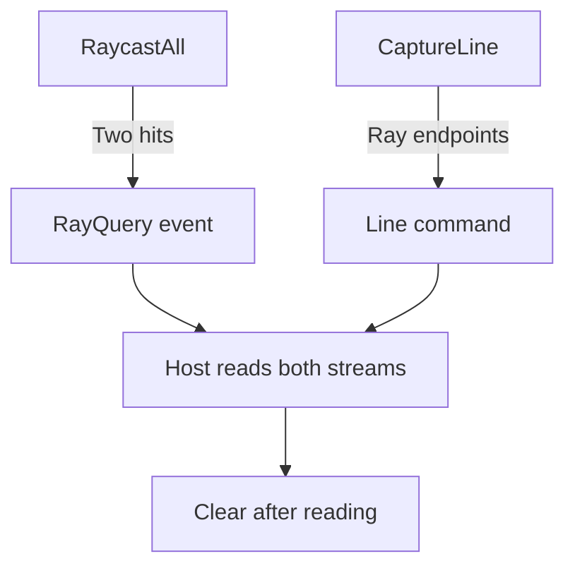

# Diagnostics

Enable `context.Diagnostics` to see what a query, collision, or solver step
reported. The context records deterministic data for drawing, logs, and replay
tools. The host decides how to present it.

Diagnostics are disabled by default. Disabled hooks return before touching
buffers. While enabled, the context appends events and draw commands to
pre-sized `SwiftList` buffers.

## Quick Read

Consider the ray in [Query Services](QUERY_SERVICES.md#quick-read). It travels
from `x = -2` to `x = 4` and hits two spheres. With capture enabled,
`Query3D.RaycastAll` records a `RayQuery` event. The event reports the hit
count and the closest collider. To draw the segment, also call `CaptureLine`
with the same endpoints.



Use the [entry point](#entry-point) to capture a window. Read the
[typed views](#typed-views-and-dispatch) to interpret events and the
[draw commands](#draw-commands) to add geometry to an overlay.
[Diagnostic Adapters](DIAGNOSTIC_ADAPTERS.md) shows how a host can draw,
log, or retain the same capture.

## Entry Point

Reserve capacity before capturing the frame or diagnostic window. In this
example, `context` is the configured world, and `start`, `end`, `mask`, and
`hits` come from [the two-sphere ray](QUERY_SERVICES.md#quick-read).

```csharp
using Gravitas.Diagnostics;

context.Diagnostics.Enable(eventCapacity: 512, drawCommandCapacity: 256);
context.Query3D.RaycastAll(start, end, mask, hits);
context.Diagnostics.CaptureLine(start, end, GravitasDiagnosticColor.Cyan);

foreach (GravitasDiagnosticEvent diagnosticEvent in context.Diagnostics.Events)
{
    // Translate to logs, overlays, replay markers, or host telemetry.
}

foreach (GravitasDebugDrawCommand command in context.Diagnostics.DrawCommands)
{
    // Translate to host-specific lines, meshes, gizmos, or debug shapes.
}

context.Diagnostics.Clear();
```

To capture a full step, enable the sink before running `Simulate()` and
`LateSimulate()`, then consume the buffers after the step.

`Events` and `DrawCommands` are read-only spans over the sink's live backing
storage. Consume them before further capture, clearing, disabling, or resetting
the sink. Copy values into host-owned storage when retaining a frame; the
[replay timeline adapter](DIAGNOSTIC_ADAPTERS.md#replay-timeline-adapter) shows
that boundary.

`Enable(...)` reserves capacity to avoid resize spikes when expected event
counts are known. `Clear()` empties both streams and resets their sequence
counters while keeping allocated buffers. `Disable()` clears and stops capture.

## Event Stream

`GravitasDiagnosticEvent` is a compact generic payload. The common fields are:

| Field                                      | Meaning                                                                            |
| ------------------------------------------ | ---------------------------------------------------------------------------------- |
| `Frame`                                    | Owning context's `long` frame count when captured.                                 |
| `Sequence`                                 | Capture order inside the current buffer.                                           |
| `Kind`                                     | Event payload type.                                                                |
| `BodyId`, `JointId`                        | Context-local IDs, or `-1` when not applicable.                                    |
| `ColliderAId`, `ColliderBId`               | Context-local collider IDs, or `-1` when not applicable.                           |
| `ColliderADimension`, `ColliderBDimension` | Collider runtime surface: `ThreeD`, `TwoD`, or `None`.                             |
| `ColliderAType`, `ColliderBType`           | 3D collider shape types when present.                                              |
| `ColliderA2DType`, `ColliderB2DType`       | 2D collider shape types when present.                                              |
| `Start`, `End`                             | Query segment, previous/current velocity, or other vector pair.                    |
| `PointA`, `PointB`                         | Contact points, hit point, acceleration delta, or shape-specific point data.       |
| `Vector`                                   | Force, torque, velocity delta, query normal, contact normal, or impulse direction. |
| `ScalarA`, `ScalarB`                       | Event-specific fixed-point values.                                                 |
| `DataA`, `DataB`                           | Event-specific integer values.                                                     |
| `Hit`                                      | Whether the event represents a successful hit/contact.                             |

The stream is scoped to one context. Collider, body, and joint IDs are not
global and must be resolved through the same context that produced the event.
Events, draw commands, and all typed views preserve the full 64-bit frame stamp.
Host log/replay schemas should preserve that width as well; sequence numbers and
buffer counts remain bounded `int` values.

## Event Families

| Family                | Event kinds                                                                                 | Typical use                                                                             |
| --------------------- | ------------------------------------------------------------------------------------------- | --------------------------------------------------------------------------------------- |
| Body deltas           | `ForceDelta`, `TorqueDelta`, `LinearVelocityDelta`, `AngularVelocityDelta`                  | Inspect force/torque application and response velocity changes.                         |
| Queries               | `GroundProbe`, `RayQuery`, `CircleQuery`, `MixedQuery`, `QuerySummary`                      | Inspect hit counts, layer masks, probe shape, reducer quality, and mixed query results. |
| Contacts and response | `Contact`, `ResponseImpulse`, `MixedContact`, `MixedResponseImpulse`, `MixedResponseIsland` | Inspect manifolds, impulse magnitude, island iteration behavior, and mixed response.    |
| Constraints           | `JointRegistered`, `JointRemoved`, `JointImpulse`, `JointLimitReached`                      | Inspect joint ownership, solve metrics, limits, motors, and collision policy.           |
| Ragdolls              | `RagdollActivated`                                                                          | Inspect activation state, link count, and joint count.                                  |

`QuerySummary` reports eligible top-level exact reducer attempts, accepted hits,
fallback hits, and rejected conservative candidates. Mixed query diagnostics use
it to show exact-versus-conservative query quality beside ordinary `MixedQuery`
hit events.

## Typed Views And Dispatch

Use a typed view to read event fields by name. For the ray, a
`GravitasRayQueryDiagnosticView` exposes `HitCount`, `HitColliderId`, and
`Distance` for the nearest hit. A `GravitasDiagnosticEventVisitor` dispatches
each event to the matching handler. For example, to read mixed contacts:

```csharp
using Gravitas.Diagnostics;

public sealed class MyDiagnosticAdapter : GravitasDiagnosticEventVisitor
{
    public override void VisitMixedContact(in GravitasMixedContactDiagnosticView contact)
    {
        // contact.Collider3DId, contact.Collider2DId,
        // contact.HasPoint3D, contact.Point3D,
        // contact.HasPoint2D, contact.Point2D,
        // contact.Normal3DTo2D, contact.Depth
    }
}
```

With the existing context, create the adapter and dispatch the captured events:

```csharp
MyDiagnosticAdapter adapter = new();
context.Diagnostics.DispatchEventsTo(adapter);
```

Available views cover the event stream:

- `GravitasForceDeltaDiagnosticView`
- `GravitasTorqueDeltaDiagnosticView`
- `GravitasVelocityDeltaDiagnosticView`
- `GravitasGroundProbeDiagnosticView`
- `GravitasRayQueryDiagnosticView`
- `GravitasCircleQueryDiagnosticView`
- `GravitasQuerySummaryDiagnosticView`
- `GravitasContactDiagnosticView`
- `GravitasResponseImpulseDiagnosticView`
- `GravitasMixedQueryDiagnosticView`
- `GravitasMixedContactDiagnosticView`
- `GravitasMixedResponseImpulseDiagnosticView`
- `GravitasMixedResponseIslandDiagnosticView`
- `GravitasJointDiagnosticView`
- `GravitasRagdollDiagnosticView`

`GravitasGroundProbeDiagnosticView` exposes both 3D and 2D probe metadata. Use
`Mode` for 3D `GroundProbeMode`, `Mode2D` for 2D `GroundProbeMode2D`, and
dimension/type properties to route shape payloads. 2D probe points are stored in
the X/Z debug plane: event X is planar X, event Z is planar Y, and event Y is
zero.

Contact and mixed-query views expose `HasPoint*` flags because canonical surface
anchors can describe a valid hit whose absolute world coordinate is outside the
`Fixed64` scalar domain. Point fields are zero when their matching flag is
false; adapters should omit that marker while still reporting the contact,
normal, depth, or query distance.

The views are read-only wrappers over the event value. Visitors and views do not
change capture storage, event ordering, diagnostic buffering, or disabled path
cost. Lower-level `TryAs...` helpers remain available for one-off filters over
known event kinds.

## Solver And Query Counters

Some diagnostics are service-local counters instead of event-buffer entries:

- CCD island and handoff work on `GravitasPhysicsService` and
  `GravitasPhysics2DService`
  - `LastContinuousCollisionIslandCount`
  - `LastContinuousCollisionIslandIterationCount`
  - `LastContinuousCollisionIslandLimitReached`
- Body time of impact (TOI) work on `SolidBody` and `SolidBody2D`
  - `LastContinuousCollisionToiIterationCount`
  - `LastContinuousCollisionToiIterationLimitReached`
- Batch queries on `Query2D`, `Query3D`, and `QueryMixed`
  - `LastBatchRequestCount`
  - `LastBatchHitCount`
  - `LastBatchCandidateCount`
  - `LastBatchMeshTriangleCandidateCount` on `QueryMixed`

These counters are deterministic frame-local state for tuning, tests, host
telemetry, and benchmark triage. They are not serialized replay state.

Each active `Joint3D` and `Joint2D` also exposes `LastSolveMetrics`, a
deterministic snapshot from the most recent solver pass. It reports row count,
anchor error, limit error, motor error, cached impulse, fresh impulse, motor
impulse, and clamped row count. These values mirror `JointImpulse` diagnostic
views and are measurement state, not extra tuning knobs.

## Draw Commands

Each `GravitasDebugDrawCommand` describes a primitive the host can draw.
The line in the ray example carries the start, end, and color. A host adapter
passes those values to its drawing API.

| Kind           | Required payload                                      |
| -------------- | ----------------------------------------------------- |
| `Line`         | `Start`, `End`, `Color`                               |
| `Ray`          | `Start`, `End`, `Color`                               |
| `Point`        | `Center`, `Radius`, `Color`                           |
| `WireSphere`   | `Center`, `Radius`, `Color`                           |
| `WireBox`      | `Center`, `HalfExtents`, `Rotation`, `Color`          |
| `WireCapsule`  | `Center`, `Radius`, `AxisLength`, `Rotation`, `Color` |
| `WireCylinder` | `Center`, `Radius`, `Height`, `Rotation`, `Color`     |
| `WireCone`     | `Center`, `Radius`, `Height`, `Rotation`, `Color`     |
| `WireTriangle` | `PointA`, `PointB`, `PointC`, `Color`                 |

Host renderers can consume draw commands through
`GravitasDebugDrawCommandVisitor` and
`context.Diagnostics.DispatchDrawCommandsTo(...)`.

Use explicit capture helpers for host-driven overlays:

```csharp
context.Diagnostics.CaptureCollider(collider, GravitasDiagnosticColor.Cyan);
context.Diagnostics.CaptureMixedCollider(collider2D, GravitasDiagnosticColor.Cyan);
context.Diagnostics.CaptureJoint(joint, GravitasDiagnosticColor.Yellow);
context.Diagnostics.CaptureLine(start, end, GravitasDiagnosticColor.Yellow);
context.Diagnostics.CaptureRay(origin, direction, maxDistance, GravitasDiagnosticColor.Green);
context.Diagnostics.CapturePoint(point, Fixed64.Half, GravitasDiagnosticColor.Red);
```

`CaptureCollider(...)` emits one command for primitive colliders and one
`WireTriangle` command per materializable mesh triangle. Mesh geometry remains
canonical in its rigid local frame; presentation triangles whose absolute
vertices cross the `Fixed64` coordinate boundary are skipped deterministically
instead of affecting simulation. Compound colliders emit one command per
internal part using the owning compound collider ID and `ColliderType`
`Compound`.

`CaptureMixedCollider(LSCollider2D, ...)` emits the finite 2D slab/prism used by
mixed collision. Circles draw as vertical wire cylinders, AABBs as wire boxes,
and polygons as top, bottom, and vertical slab edges. Commands are tagged with
`GravitasColliderDimension.TwoD`.

`CaptureJoint(Joint3D, ...)` emits anchors, anchor-error line, and active
angular axes for hinge, cone-twist, and fixed joints.
`CaptureJoint(Joint2D, ...)` emits planar anchors, anchor-error line, and
prismatic slider axis where applicable.

## Performance Rules

- Leave diagnostics disabled in normal hot-path measurements unless the
  measurement is about diagnostics.
- Reserve realistic capacities with `Enable(...)` before capture-heavy runs.
- Call `Clear()` once the host consumes a frame or diagnostic window.
- Do not project diagnostics through `SwiftCollections.Observable` in
  authoritative simulation paths without tests and benchmarks for ordering and
  notification cost.
- Add benchmarks when new event hooks or draw commands touch collision,
  partitioning, queries, body integration, or response paths.

## Boundaries

- Diagnostics are same-thread context buffers.
- Event storage is intentionally generic. Add a documented event kind or typed
  view when a subsystem needs richer diagnostics.
- Draw commands are wire/debug descriptions, not mesh generation utilities.
- Hosts remain responsible for rendering, logging, persistence, and replay UI.

## Source Map

- [Diagnostic sink and capture buffers](https://github.com/mrdav30/Gravitas/blob/main/src/Gravitas/Diagnostics/GravitasDiagnosticSink.cs)
- [Draw capture helpers](https://github.com/mrdav30/Gravitas/blob/main/src/Gravitas/Diagnostics/GravitasDiagnosticSink.Draw.cs)
- [Event payloads and views](https://github.com/mrdav30/Gravitas/tree/main/src/Gravitas/Diagnostics/Events)
- [Debug draw payloads and views](https://github.com/mrdav30/Gravitas/tree/main/src/Gravitas/Diagnostics/DebugDraw)
- [Diagnostics tests](https://github.com/mrdav30/Gravitas/tree/main/tests/Gravitas.Tests/Diagnostics)
- [Diagnostics benchmarks](https://github.com/mrdav30/Gravitas/tree/main/tests/Gravitas.Benchmarks/Diagnostics)
