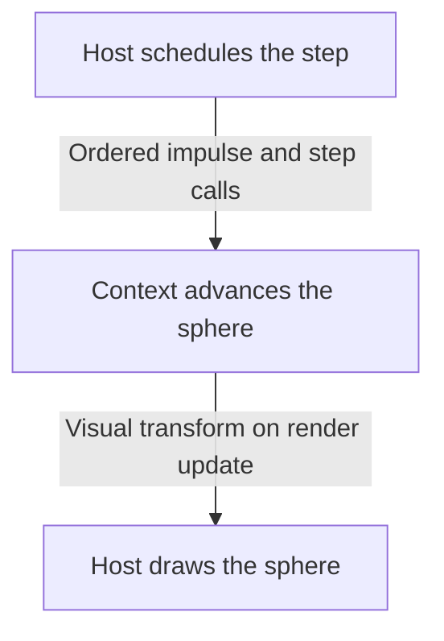

# Gravitas Overview

Gravitas runs deterministic, engine-agnostic physics for lockstep simulations
and games. The host applies commands and decides when to step. One
`GravitasWorldContext` owns each simulation's physics state. FixedMathSharp
provides fixed-point math, SwiftCollections provides low-allocation collections,
and GridForge provides spatial storage and traversal.

Project resources: [documentation site](https://mrdav30.github.io/Gravitas/),
[API reference](https://mrdav30.github.io/Gravitas/api/Gravitas.html),
and [coverage report](https://mrdav30.github.io/Gravitas/coverage/).

If this is your first Gravitas integration, start with
[Getting Started](GETTING_STARTED.md) before using this page as the technical
map.

## Quick Read

Follow the sphere from [Getting Started](GETTING_STARTED.md). The host
creates its object and exposes a fixed-point transform through `IMatterAgent`.
It applies the impulse and calls both fixed-step phases. The context advances the
sphere's body state. On a presentation update, the host can read its published
visual transform and draw the sphere.

The sphere, its collider, and all physics services belong to one context.
A 3D simulation uses `SolidBody` and `LSCollider`. Planar simulations use
`SolidBody2D` and `LSCollider2D`. Choose `Both` for independent 2D and 3D
simulation, or `Mixed` when colliders in those dimensions should interact.
See [runtime modes](DIMENSIONS.md) for the geometry and query rules.

For save and load, the host creates the runtime objects and Chronicler
populates them. For debugging, Gravitas exposes diagnostic data and the host
adapter turns it into logs or drawings. The [ownership map](#core-mental-model)
lists what each side manages.

## Foundation Libraries

Gravitas is the physics layer of a small deterministic stack. Read the sibling
project docs when you need the lower-level contracts behind a Gravitas API.

| Library          | What Gravitas uses it for                                                                                        | More                                                      |
| ---------------- | ---------------------------------------------------------------------------------------------------------------- | --------------------------------------------------------- |
| FixedMathSharp   | `Fixed64`, deterministic vectors, quaternions, transforms, matrices, bounds, rays, planes, and geometry helpers. | [Repository](https://github.com/mrdav30/FixedMathSharp)   |
| SwiftCollections | Low-allocation lists, sets, queues, pools, and caller-owned buffers used by hot-path services and query APIs.    | [Repository](https://github.com/mrdav30/SwiftCollections) |
| GridForge        | Explicit `GridWorld` ownership, voxel identities, traversal, partition backing, and spatial candidate gathering. | [Repository](https://github.com/mrdav30/GridForge)        |

## Reading Path

Use the [guide directory](../index.md#guides) to find the next guide for your
task.

## Core Mental Model

The host owns:

- the application loop and deterministic command/input ordering.
- renderers, ECS, engine objects, networking, pooling, and editor tooling.
- the `GridWorld` when using `GravitasWorldContext.Attach(...)`.
- host objects that implement `IMatterAgent`.
- serialization shell construction before Chronicler populates state.

Gravitas owns, per context:

- fixed-step timing through `GravitasClock`.
- settings and physical environment values.
- 3D bodies, colliders, constraints, ragdolls, pairs, response, and queries.
- 2D bodies, colliders, constraints, ragdolls, pairs, response, and queries.
- mixed 2D/3D candidate gathering, pairs, constrained response, CCD, queries,
  and diagnostics when `PhysicsRuntimeMode.Mixed` is active.
- GridForge-backed partition payloads and retained partition cleanup.
- lockstep coroutines and lifecycle hooks.
- deterministic replay hashing.
- diagnostic event and debug draw buffers when enabled.

## Main Types

| Type                            | Role                                                                                                                                                   |
| ------------------------------- | ------------------------------------------------------------------------------------------------------------------------------------------------------ |
| `GravitasWorldContext`          | Owns one active `GridWorld` plus all context-local runtime services.                                                                                   |
| `IMatterAgent`                  | Host boundary for context, fixed transform, hierarchy intent, and interaction state.                                                                   |
| `SolidBody`                     | 3D body state: position, rotation, motion, mass, inertia, grounding, CCD, sleep, visualization publishing, and Chronicler recording.                   |
| `SolidBody2D`                   | 2D body state: X/Z position, scalar yaw, planar motion, scalar inertia, support state, CCD, sleep, visualization publishing, and Chronicler recording. |
| `LSCollider`                    | 3D collider identity, shape, bounds, layer/filter state, material, partition state, pairs, and events.                                                 |
| `LSCollider2D`                  | 2D collider identity, X/Z shape/bounds, layer/filter state, material, partition state, mixed slab state, pairs, and events.                            |
| `PhysicsRuntimeMode`            | Validated runtime routing: `ThreeD`, `TwoD`, `Both`, or `Mixed`.                                                                                       |
| `GravitasPhysicsService`        | 3D body/collider registration, CCD, pair ownership, response islands, sleep, and visualization.                                                        |
| `GravitasPhysics2DService`      | 2D body/collider registration, CCD, pair ownership, response islands, planar support, sleep, and visualization.                                        |
| `GravitasMixedCollisionService` | Mixed broad phase, pair lifecycle, constrained response, CCD handoff, retained partition cleanup, and diagnostics.                                     |
| `GravitasConstraint3DService`   | 3D joints, ragdolls, linked-collider filtering, motor handoff, replay hashing, and metrics.                                                            |
| `GravitasConstraint2DService`   | 2D joints, ragdolls, linked-collider filtering, motor handoff, replay hashing, and metrics.                                                            |
| `GravitasQuery3DService`        | 3D raycasts, swept-sphere and convex-source sweeps, cone volumes, and X/Z projected-circle overlaps.                                                   |
| `GravitasQuery2DService`        | 2D overlaps, segment raycasts, swept-circle queries, batching, and hit ordering.                                                                       |
| `GravitasQueryMixedService`     | Explicit mixed sphere-against-2D and circle-against-3D sweeps.                                                                                         |
| `GravitasDiagnosticSink`        | Disabled-by-default context diagnostics for events and renderer-neutral debug draw commands.                                                           |

## Typical Flow

1. Create or attach a `GravitasWorldContext`.
2. Configure the underlying `GridWorld` with GridForge grids covering the
   simulation space.
3. Expose host objects through `IMatterAgent.Context` and
   `IMatterAgent.Transform`.
4. Create colliders and bodies.
5. Initialize runtime objects so Gravitas can allocate context-local IDs,
   calculate runtime shape data, and partition colliders.
6. Apply deterministic commands for the frame.
7. Call `context.Simulate()` and `context.LateSimulate()` from the fixed step.
8. Optionally compute `context.ComputeReplayHash()` for lockstep/replay
   validation.
9. Call `context.Visualize()` and `context.LateVisualize()` from presentation
   timing.
10. Deactivate objects before pooling/despawn and reset or dispose the context
    at session boundaries.

## Runtime Surface

| Area          | Supported surface                                                                                                                                                                          |
| ------------- | ------------------------------------------------------------------------------------------------------------------------------------------------------------------------------------------ |
| 3D            | primitive, mesh, and compound colliders; explicit dynamic/kinematic/static bodies; CCD; constraints; ragdolls; grounding; queries; diagnostics; replay.                                    |
| 2D            | circle, capsule, AABB, convex polygon, and compound colliders; planar body dynamics; scalar angular response; grounding/support; CCD; constraints; ragdolls; queries; diagnostics; replay. |
| Mixed 2D/3D   | embedded 2D slabs, mixed broad phase, mixed pairs, constrained response, explicit mixed queries, mixed CCD hooks, dimension-tagged diagnostics, slab debug draw.                           |
| Collision     | deterministic broad phase, narrow phase, manifolds, response islands, warm starts, materials, sleep/wake, notifications, cleanup.                                                          |
| Queries       | closest/all-hit and batch APIs for 3D, 2D, and mixed query families with caller-owned buffers.                                                                                             |
| Serialization | Chronicler populate-existing-shell state transfer and replay hash conformance.                                                                                                             |
| Diagnostics   | deterministic event streams, debug draw commands, typed views, visitors, and host adapter patterns.                                                                                        |

## Intentional Boundaries

These are deliberate public-runtime boundaries:

- `PhysicsRuntimeMode.Both` does not create mixed contacts. Use
  `PhysicsRuntimeMode.Mixed` for cross-dimensional collision.
- Mixed-dimension joints are not part of the articulated-body model. Use 3D
  joints with `SolidBody` and 2D joints with `SolidBody2D`.
- Concave mesh source sweeps and raw mesh source query APIs are not exposed.
  Author concave-looking movers as stable convex compound parts.
- Public query services are same-thread per context service and reuse
  service-owned scratch.
- Renderer, editor, logging, and replay UI integrations live in host adapters,
  not in `src/Gravitas`.
- Chronicler loading populates existing shells; it does not create engines,
  transforms, worlds, bodies, or colliders from data.

## Source Map

- Context and lifecycle
  - [Context](https://github.com/mrdav30/Gravitas/blob/main/src/Gravitas/Runtime/GravitasWorldContext.cs)
  - [Clock](https://github.com/mrdav30/Gravitas/blob/main/src/Gravitas/Runtime/GravitasClock.cs)
  - [Lifecycle hooks](https://github.com/mrdav30/Gravitas/blob/main/src/Gravitas/Runtime/LifecycleHooks/GravitasLifecycleHooks.cs)
- Host boundary and bodies
  - [Host agent](https://github.com/mrdav30/Gravitas/blob/main/src/Gravitas/Core/IMatterAgent.cs)
  - [3D body](https://github.com/mrdav30/Gravitas/blob/main/src/Gravitas/Core/3D/Bodies/SolidBody.cs)
  - [2D body](https://github.com/mrdav30/Gravitas/blob/main/src/Gravitas/Core/2D/Bodies/SolidBody2D.cs)
- Physics services
  - [3D](https://github.com/mrdav30/Gravitas/tree/main/src/Gravitas/Core/3D)
  - [2D](https://github.com/mrdav30/Gravitas/tree/main/src/Gravitas/Core/2D)
  - [Mixed](https://github.com/mrdav30/Gravitas/tree/main/src/Gravitas/Core/Mixed)
- [Collider implementations](https://github.com/mrdav30/Gravitas/tree/main/src/Gravitas/Colliders)
- [Detection and response](https://github.com/mrdav30/Gravitas/tree/main/src/Gravitas/CollisionHandling)
- Constraints
  - [3D constraints](https://github.com/mrdav30/Gravitas/tree/main/src/Gravitas/Constraints/3D)
  - [2D constraints](https://github.com/mrdav30/Gravitas/tree/main/src/Gravitas/Constraints/2D)
- [Query implementations](https://github.com/mrdav30/Gravitas/tree/main/src/Gravitas/Queries)
- Serialization and replay
  - [Replay hashing](https://github.com/mrdav30/Gravitas/tree/main/src/Gravitas/Determinism)
  - [Settings saver](https://github.com/mrdav30/Gravitas/blob/main/src/Gravitas/Settings/PhysicsSettingsSaver.cs)
- [Diagnostic implementations](https://github.com/mrdav30/Gravitas/tree/main/src/Gravitas/Diagnostics)
- Tests and benchmarks
  - [Tests](https://github.com/mrdav30/Gravitas/tree/main/tests/Gravitas.Tests)
  - [Benchmarks](https://github.com/mrdav30/Gravitas/tree/main/tests/Gravitas.Benchmarks)
