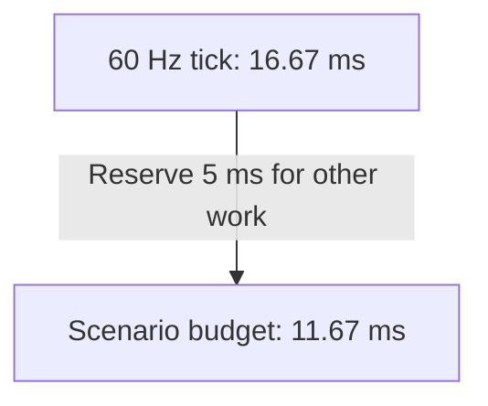

# Workload And Tuning

Start by measuring the busiest tick your host needs to support. In a strategy
scene with 1,024 registered actors, a quiet frame and a crowded frame can have
very different costs. The difference depends on how many actors are awake,
how many contacts they create, how many partitions they cover, and which
host work runs that tick.

Set a time budget first. Then replay the same scene while changing one
setting at a time, checking both timing and the resulting physics.

## Set The Host Budget

The fixed interval in milliseconds is `1000 / tick rate`. At 60 Hz it is
16.67 ms. If the host reserves 5 ms for work outside the measured scenario,
the scenario has 11.67 ms available. Choose the reserve and the tolerated
miss rate from the application's own latency requirements. For example, a
12 ms scenario frame fits the full 60 Hz interval but exceeds the 11.67 ms
budget with that reserve.

Measure two windows on the target host:

1. **Physics step.** Time `Simulate()` and `LateSimulate()` together, including
   the hooks and coroutines that execute inside them.
2. **Scenario frame.** Also include ordered command application, actor
   registration and retirement, and scheduled queries. Reserve time only for
   host work outside this window.

Keep wall-clock measurements outside authoritative decisions. Preallocate
sample buffers and record the frame and stage for each miss. During clean
timing runs, defer replay hashes, metric aggregation, and output until after
the timed window. Use a separate pass for expensive observation or profiling
and compare its replay results with the timing control. [Host lifecycle](HOST_INTEGRATION.md#fixed-loop)
and [diagnostics](DIAGNOSTICS.md) describe the available boundaries.

## Describe And Replay The Workload

Record settings, runtime and package versions, hardware, initial state, and the
ordered commands. Include quiet, sparse, and crowded frames, first activation,
and repeated wake, spawn, retirement, and recovery. Keep local spacing and
encounter density explicit when scaling the actor count.

| Record | Why it matters |
| --- | --- |
| Registered and peak awake bodies by mode and mobility | A mostly sleeping population can have very different cost from an equally sized active one. |
| Local density, collider types and extents, covered partitions | Large shapes or tighter cells can increase coverage even with steady actor count. |
| Candidate pairs, touching pairs, connected contacts, and islands | Broad-phase work, retained contacts, and solver work can scale differently. |
| Query type, cadence, and candidate counts, plus CCD bodies and time-of-impact work | A small number of scheduled or fast-moving actors can create their own bursts. |
| First-use and warmed median, p95, p99, maximum, and misses by stage | A pooled percentile can hide an overloaded stage or a synchronized wake burst. |

Verify replay and expected outcomes for each configuration. For example, check
floor support, projectile stops, connected encounters, and ordered query hits.
Changing a setting can legitimately change the trace. Check reproducibility
within that setting and compare behavior against the intended physical bounds.

## Compare Partition Cell Sizes

Start with cells that suit the collider extents and local spacing. Hold the
scene bounds, commands, materials, and solver settings fixed. For a 3D scene
with a floor, compare horizontal X/Z sizes while keeping Y fixed to separate
horizontal coverage and candidate effects. Smaller cells can raise per-body
coverage and lookup costs. Larger cells can increase candidate and contact
work even when partition refresh gets cheaper. Measure both before choosing.
[Collision Broad Phase](COLLISION_BROAD_PHASE.md)

### Example Capture At 60 Hz

One 60 Hz synthetic strategy scene used pure 2D circles and boxes or pure 3D
spheres and boxes, manual grounding, six discrete solver iterations, and CCD
on the scheduled projectiles. The capture used a Windows x64 Core i7-9700K
and .NET 10 Release.
Each configuration pooled 20,480 measured frames from two fresh processes
after four complete warmup cycles per process. The active scene used up to
32 awake actors per 256 registered actors.
[Capture protocol](https://github.com/mrdav30/Gravitas/blob/bb84d8552c422442de965961d40914d5299505de/docs/feature-work/done/2026-10-06-evolving-game-capacity-and-soak-plan.md#soak-protocol) ·
[Warmed frame results](https://github.com/mrdav30/Gravitas/blob/bb84d8552c422442de965961d40914d5299505de/docs/feature-work/done/2026-10-06-evolving-game-capacity-and-soak-plan.md#warmed-frame-tails)

| Configuration | Warmed scenario p99 | Warmed misses of 16.67 ms |
| --- | ---: | ---: |
| 2D, 256 actors | 1.08 ms | 0 / 20,480 |
| 2D, 1,024 actors | 3.81 ms | 0 / 20,480 |
| 3D, 256 actors | 3.75 ms | 0 / 20,480 |
| 3D, 1,024 actors, X/Z 8 and Y 4 | 15.65 ms | 9 / 20,480 |
| 3D, 1,024 actors, X/Z 16 and Y 4 | 12.28 ms | 3 / 20,480 |

In the 1,024-actor 3D scene, 16-unit cells improved **crowded** warmed p99
from 15.96 to 12.66 ms and retained about 2.9 MiB more managed heap.
[Warmed frame results](https://github.com/mrdav30/Gravitas/blob/bb84d8552c422442de965961d40914d5299505de/docs/feature-work/done/2026-10-06-evolving-game-capacity-and-soak-plan.md#warmed-frame-tails) ·
[Retained memory results](https://github.com/mrdav30/Gravitas/blob/bb84d8552c422442de965961d40914d5299505de/docs/feature-work/done/2026-10-06-evolving-game-capacity-and-soak-plan.md#retained-managed-memory)

The first synchronized wake at 16 units missed 60 Hz in all six fresh-context
comparisons, while the warmed wake bursts fit at both sizes. Four-unit cells missed every
crowded frame in the short comparison. Keep 8 as the reference for this scene.
Compare 16 if sustained crowd cost matters and first-use latency and memory fit
your host budget. At the example 11.67 ms budget, both 1,024-actor 3D settings
exceed the crowded p99 target. [Fresh-context cell-size comparison](https://github.com/mrdav30/Gravitas/blob/bb84d8552c422442de965961d40914d5299505de/docs/feature-work/done/2026-10-06-evolving-game-capacity-and-soak-plan.md#matched-1024-actor-3d-xz-cell-sizes)

## Tune One Policy At A Time

- **Awake population and density.** Track the work created by simultaneous
  wakes and connected contacts. If the game permits staggered activation, replay
  the new command schedule and check response and gameplay timing. Keep sleeping
  and unregistered populations distinct in the capture.
- **CCD.** Choose continuous modes for bodies whose motion needs a swept
  collision check. Verify supported shapes and motion, then compare
  fast-projectile or thin-obstacle cases against the intended stop positions
  and record time-of-impact work and iteration limits.
  [Continuous Collision Detection](CONTINUOUS_COLLISION_DETECTION.md)
- **Grounding and solver iterations.** Keep the baseline policy and iteration
  count fixed during capacity comparisons. To change either, pair frame costs
  with measurements of support, penetration, settling, drift, or joint error
  on the affected fixtures. Accept a setting only when it meets the host's
  physical error bounds and tick budget. [Collision Response](COLLISION_RESPONSE.md)
- **Queries and shapes.** Measure the actual cadence, filters, and geometry.
  Reuse caller-owned hit buffers and verify ordered results. Curved feature
  evaluation can cost time even when another feature wins or a candidate
  produces no contact. Count dispatch and expensive-path work before using
  observed final contacts to explain cost. [Query Services](QUERY_SERVICES.md)

## Compare Tick Rates And Solver Passes

Start with the default six `PhysicsSettings.DiscreteSolverIterations`.
Compare settings on the same authored scene, keeping masses, geometry,
materials, and commands fixed. At different tick rates, run for equal
simulated time and apply disturbances at the same simulated times. Include
settled support, repeated wake and recovery, and any drops or impacts your
host expects. Use a fresh context for each run.

Measure the errors the scene must tolerate. For stacks, check both support
interfaces, residual penetration, drift, and whether a body reaches an
unintended surface. For jointed scenes, record anchor separation, limit
error, and body displacement independently. A tip can move about a pinned
root while its anchors remain close. For supported groups, verify that the
group sleeps between disturbances and wakes together. Compare replay within
each setting and use complete-step timings to check the host's reserved
physics budget. [Collision Response](COLLISION_RESPONSE.md)

### Example Solver-Pass Comparison

In an eight-second 60 Hz pass sweep on a Windows x64 Core i7-9700K with
.NET 10 Release, the same spatial fixtures produced these ranges of
per-launch full-step p95 values after the first second.
[Duration quality measurements](https://github.com/mrdav30/Gravitas/blob/bb84d8552c422442de965961d40914d5299505de/docs/feature-work/done/2026-10-06-long-duration-physics-quality-and-tuning-plan.md#duration-quality-at-2612-passes)

| Fixture | 2 passes | 6 passes | 12 passes | Physical result |
| --- | ---: | ---: | ---: | --- |
| Centered 100:1 top-loaded stack with repeated pulses | 0.23–0.24 ms | 0.31–0.32 ms | 0.45–0.50 ms | Both supports held, residual depth stayed within 1/16 unit, and both bodies woke on all three pulses. |
| Contact-free chain with a 100:1 heavy tip | 1.59–1.66 ms | 3.13–3.35 ms | 5.49–6.55 ms | At six and twelve passes, anchor gaps met the bounds and tip displacement stayed near 1.15 units, above the one-unit target. |

Two passes also preserved the measured homogeneous heavy-bottom supports,
while the sixteen-stack mixed-load control lost a support at that setting.
The homogeneous sixteen-stack case exceeded 16.67 ms on every measured
six-pass step. Raising the pass count can change which exact response
paths execute, so cost can move in either direction. Measure representative
load mixes before applying a setting to the whole context.

Six passes met the geometry and connected-wake checks for the matched
planar and spatial ragdoll suite at 32 and 60 Hz. Two passes failed the
supported planar wake check and several drop geometry checks. In the
six-pass supported spatial control, four launches per rate had zero
full-interval overruns, with worst steps of 21.53 ms at 32 Hz and
16.62 ms at 60 Hz. The 60 Hz result leaves about 0.04 ms before any
additional host work. Measure the recovery frames and the host reserve
when choosing a rate.
[Supported spatial ragdoll measurements](https://github.com/mrdav30/Gravitas/blob/bb84d8552c422442de965961d40914d5299505de/docs/feature-work/done/2026-10-06-long-duration-physics-quality-and-tuning-plan.md#grv-benchmark-038-closeout)

## Check Save And Populate Continuation

For hosts that populate existing bodies from saves, record a checkpoint
after real simulation steps. Exercise both free motion and awake support,
and continue with the same ordered commands. Compare exact replay against
a control with the same clock, registrations, retained pair history, and
cache invalidation as the populated world. Also compare physical recovery
against an uninterrupted run with warm contact impulses. Clearing warm
impulses on population can change the active-contact trace, so check
support and measure position, velocity, and rotation deltas over the
continuation window. [Serialization And Replay](SERIALIZATION.md#replay-workflow)

## Check Long-Session Memory

Run repeated equal-envelope churn in the same context. Record startup,
warmup, and steady allocation separately from spawn and wake bursts.
Track GC activity, registered objects, and active, retained, and pooled
partitions. Compare retained managed memory after equal cooldown boundaries,
after retirement, and after disposal in a separate pass with full collections
outside timed frames. Record process working set separately because it includes
runtime and native memory. A plateau applies to the measured envelope and
duration. Repeat the comparison when actor policy, geometry, target hardware,
or package versions change materially.

A warmed context can still visit a partition's dynamic or awake membership
for the first time. Count distinct first touches per step and compare them
with repeated visits before reserving storage for large static floors.
